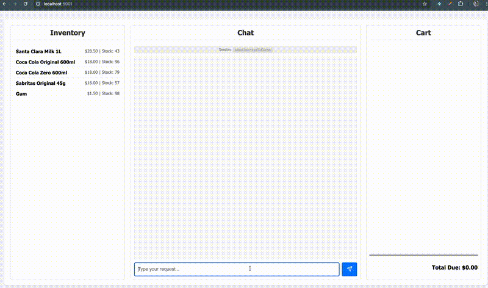

# AI Agent Cash Register

> **Hey!** I had a lot of fun with this challenge. I wasn't sure how to approach a POS system from an AI Engineer perspective, so I decided to revolutionize it with a **human language interface**. This probably wasn't what you expected, but it was a blast to build. 😄



---

## 1. Architecture Overview (The "Why")

This project implements a robust **Stateless Agent / Stateful Database** architecture, designed to handle the complexities of a conversational commerce interface while ensuring data integrity and scalability.

*   **LangGraph Orchestration:** We utilize **LangGraph** to manage the conversational flow and state transitions. The agent itself is stateless between turns; the conversation history and state are reconstructed for each request.
*   **Stateful Persistence (SQLite):** All critical data—cart contents, inventory, and conversation history—is persisted in a **SQLite** database. This ensures that the application can survive server restarts and allows for complex, multi-turn interactions without losing context.
*   **Optimized Command Handling:** The `/clear` command is intercepted directly in the backend (Python) and **never touches the LLM**. This design decision significantly reduces latency and API costs for administrative actions, ensuring a snappy user experience for reset operations.

## 2. The Agent Graph

The architecture uses a **multi-node graph** with specialized nodes for routing, checking, decision-making, and updating. This design enables **model flexibility**: each node can use a different LLM, allowing lightweight local models (e.g., Ollama, LM Studio) for simple tasks like routing, while reserving more capable models for complex decisions.

```
                           START
                             │
                             ▼
                     ┌───────────────┐
                     │    ROUTER     │  ← Classifies intent (add/remove/checkout/off_topic)
                     │   (LLM #1)    │    Can use lightweight local model
                     └───────────────┘
                             │
         ┌───────────┬───────┴───────┬───────────┐
         ▼           ▼               ▼           ▼
     [add_flow] [remove_flow]  [checkout]   [off_topic]
         │           │               │           │
         ▼           ▼               ▼           │
    ┌─────────┐ ┌─────────┐   ┌──────────┐      │
    │  CHECK  │ │  CHECK  │   │  CHECK   │      │ (static response)
    │ (tools) │ │ (tools) │   │  (tools) │      │
    └─────────┘ └─────────┘   └──────────┘      │
         │           │               │           │
         ▼           ▼               ▼           │
    ┌─────────┐ ┌─────────┐   ┌──────────┐      │
    │ DECIDE  │ │ DECIDE  │   │  DECIDE  │      │
    │ (LLM #2)│ │ (LLM #2)│   │ (LLM #2) │      │
    └─────────┘ └─────────┘   └──────────┘      │
         │           │               │           │
     ┌───┴───┐   ┌───┴───┐     ┌────┴────┐     │
     ▼       ▼   ▼       ▼     ▼         ▼     │
  UPDATE   ASK UPDATE  ASK  UPDATE     ASK     │
     │       │   │       │     │         │     │
     └───────┴───┴───────┴─────┴─────────┴─────┘
                             │
                             ▼
                     ┌───────────────┐
                     │   RESPONSE    │  ← Generates final user-facing message
                     │   (LLM #3)    │
                     └───────────────┘
                             │
                             ▼
                           END
```

### Why Two Levels? (Check → Decision → Update)

The separation of **Check Tools** (read-only) and **Update Tools** (modify state) into distinct phases serves two critical purposes:

1.  **Safety Before Mutation:** The Check phase verifies availability, resolves ambiguity, and validates the request *before* any database writes occur. This prevents the bug where an item gets removed but the LLM still asks for clarification (action executed before decision was finalized).

2.  **100% Local Model Deployment:** By separating concerns into single-purpose nodes, the architecture enables **complete replacement of paid API models** with local alternatives:
    *   **Router Node**: Simple intent classification → Lightweight local model (e.g., Llama 3.2 via Ollama)
    *   **Check/Decision Nodes**: Context analysis → Local model with good reasoning (e.g., Mistral, Qwen)
    *   **Response Node**: Natural language generation → Any local model

    This design eliminates API costs entirely for production deployments, making the system viable for cost-sensitive or offline environments.

> **Note:** For practical demonstration purposes, this implementation uses **gpt-5-nano** across all nodes. In production, each node can be configured independently.

### Tool Groups

| Group | Tools | Purpose |
|-------|-------|---------|
| **Check** | `get_product_catalog`, `get_cart_contents` | Read-only verification |
| **Update** | `add_item_tool`, `remove_item_tool`, `checkout_tool` | State modification |

## 3. "The Twist" & Math Safety (Critical)

A core requirement was to solve the "Cash Register Problem" with a specific twist, while ensuring financial accuracy.

*   **Deterministic Math:** **The LLM does NOT do math.** Relying on an LLM for arithmetic is a known anti-pattern. Instead, the LLM extracts the *intent* (e.g., "checkout with $50") and passes parameters to the `checkout_tool`. The actual calculation is performed by Python code.
*   **Integer Precision:** All monetary values are stored and calculated as **integers (cents)** to strictly avoid floating-point precision errors common in financial software.
*   **The "Twist" Implementation:**
    *   **Standard Logic:** For most transactions, a **Greedy Strategy** is used to minimize the number of coins/bills returned.
    *   **Divisible by 3 Logic:** If the total amount due is divisible by 3 (e.g., $3.00), the system switches to a **Random Change Strategy**. This strategy randomly selects valid denominations until the correct change amount is reached, adding a playful element to the interaction while maintaining mathematical correctness.

## 4. Handling Ambiguity (AI Engineering)

The agent is engineered to handle vague or misspelled user requests gracefully, prioritizing accuracy over guessing.

*   **Search & Analyze:** When a user requests an item (e.g., "Coke"), the Check node uses `get_product_catalog` to inspect available options.
*   **Decision Phase:** The Decision node analyzes matches:
    *   **Exact Match**: Proceeds to Update
    *   **Multiple Matches**: Asks for clarification (e.g., "Original or Zero?")
    *   **No Match**: Informs the user
*   **Context-Aware Router:** The Router considers conversation history, so when a user responds "original" to a clarification question, it correctly routes to `add_flow` instead of `off_topic`.
*   **Scalability Note:** For this MVP, the product catalog is loaded into context. A production system with thousands of SKUs would use Vector Search or Trigram matching.

## 5. Project Structure

```text
.
├── api/
│   └── routes.py           # Flask endpoints (Chat, State, /clear logic)
├── db/
│   ├── database.py         # SQLAlchemy setup and session management
│   └── models.py           # Database schema (Product, Cart, CartItem)
├── graph/
│   ├── agent.py            # LangGraph state graph definition
│   ├── nodes.py            # Router, Check, Decision, Update, Response nodes
│   ├── tools.py            # Check Tools + Update Tools (separated)
│   └── prompts.py          # Specialized prompts for each node
├── utils/
│   └── change_calculator.py # Core business logic (Greedy & Random strategies)
├── static/                 # Frontend assets (HTML, CSS, JS)
├── tests/                  # Unit tests
├── app.py                  # Application entry point
└── requirements.txt        # Project dependencies
```

## 6. Test Results & Validation

The system has undergone rigorous blackbox integration testing. The full report is available in [TEST_REPORT.md](./TEST_REPORT.md).

**Test Coverage Summary:**
We successfully validated 5 critical scenarios:
1.  **Happy Path:** Standard flow of adding items and checking out.
2.  **Stock Limit Protection:** Verifying the agent respects inventory limits.
3.  **The "Twist":** Confirming the Random Change Strategy triggers correctly for totals divisible by 3.
4.  **Multiple Items:** Ensuring the cart correctly aggregates different products and calculates totals.
5.  **Ambiguity Resolution:** Verifying the agent asks for clarification on ambiguous requests.

**Key Validations:**
*   ✅ **Math Safety:** Confirmed that all calculations are accurate and performed deterministically.
*   ✅ **Database Consistency:** No orphaned records or negative stock states were observed.
*   ✅ **AI Behavior:** The agent correctly orchestrates tools and handles user dialogue.

## 7. How to Run

1.  **Install Dependencies:**
    ```bash
    python3 -m venv venv
    source venv/bin/activate
    pip install -r requirements.txt
    ```

2.  **Configure Environment:**
    ```bash
    cp .env.example .env
    # Edit .env and add your OPENAI_API_KEY
    ```

3.  **Run the Server:**
    ```bash
    python app.py
    ```
    The application will start on `http://localhost:5001`.

4.  **Access the UI:**
    Open your browser to the URL displayed in the terminal.

## 8. Future Improvements

*   **Full Local Deployment:** Configure each node to use Ollama/LM Studio models for 100% offline, zero-cost operation.
*   **Vector Search:** Replace `get_product_catalog` with semantic search for large inventories.
*   **Streaming Responses:** Implement SSE for real-time response streaming.
*   **Multi-language Support:** Extend prompts for Spanish/English bilingual interactions.
