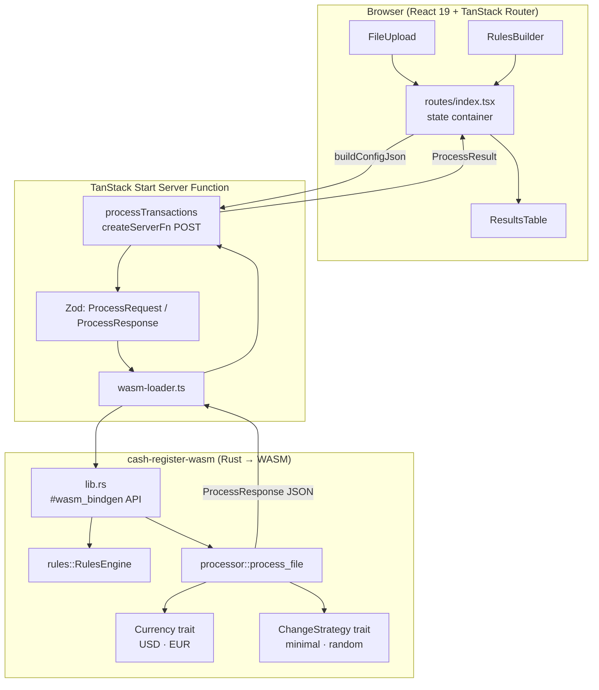
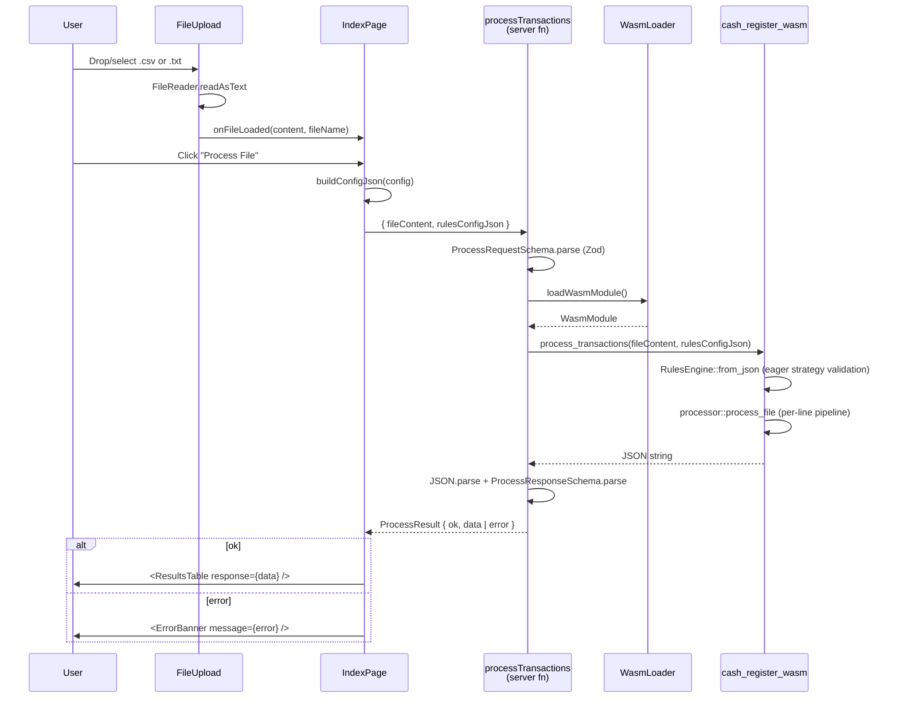

# System Overview

CashRegister is a two-crate project: a **Rust/WebAssembly core** that computes change denominations for transaction files, and a **React + TanStack Start frontend** that wraps the WASM module behind a file-upload UI and a rules-builder form. The WASM core is built with `wasm-pack --target bundler` and imported directly into the Vite bundle via server-only code, so all processing runs inside a TanStack Start server function.



## Directory Structure

```
CashRegister/
├── app/                                  # React + TanStack Start frontend
│   ├── src/
│   │   ├── routes/                       # File-based routing (__root, index)
│   │   ├── components/                   # UI components + __tests__
│   │   │   ├── FileUpload.tsx            # Drag-drop file reader
│   │   │   ├── RulesBuilder.tsx          # Config form (currency, strategies, rules)
│   │   │   ├── ResultsTable.tsx          # Per-line output table + summary
│   │   │   └── ErrorBanner.tsx           # Dismissible error display
│   │   ├── lib/                          # Shared Zod schemas, defaults, serializer
│   │   ├── server/                       # Server function + WASM loader (server-only)
│   │   ├── wasm-pkg/                     # wasm-pack output (consumed by server/)
│   │   ├── styles/app.css                # Hand-written dark theme (no Tailwind)
│   │   ├── test/setup.ts                 # jest-dom matcher extension
│   │   ├── router.tsx                    # getRouter() factory
│   │   └── routeTree.gen.ts              # Auto-generated route tree
│   ├── vite.config.ts                    # wasm + topLevelAwait + tanstackStart + react
│   ├── vitest.config.ts                  # jsdom, excludes wasm-pkg
│   └── package.json                      # bun scripts: wasm:build, dev, build, test
├── cash-register-wasm/                   # Rust WASM crate
│   ├── src/
│   │   ├── lib.rs                        # #[wasm_bindgen] API surface
│   │   ├── types.rs                      # Money (i64 cents), Denomination, ParsedTransaction
│   │   ├── error.rs                      # CashError (thiserror)
│   │   ├── currency/                     # Currency trait + USD + EUR
│   │   ├── processor/                    # process_file pipeline + parser + formatter
│   │   ├── rules/                        # RulesEngine + RulesConfig schema (serde)
│   │   └── strategy/                     # ChangeStrategy trait + minimal + random
│   ├── tests/integration_tests.rs        # Black-box processor tests
│   ├── pkg/                              # wasm-pack build output
│   └── Cargo.toml                        # cdylib + rlib, wasm-bindgen, rand/js, serde
├── README.md                             # Product problem statement
└── sample-input.txt                      # 3-line USD example
```

## Module Guide

### app/routes — Routing

**Purpose**: Single-route SPA shell.
**Entry point**: [app/src/routes/__root.tsx](app/src/routes/__root.tsx)
**Key files**:
| File | Purpose |
|------|---------|
| [__root.tsx](app/src/routes/__root.tsx) | RootDocument shell (HTML + HeadContent + Scripts) and RootLayout outlet |
| [index.tsx](app/src/routes/index.tsx) | The only page — owns all app state and orchestrates file → WASM → results flow |
| [router.tsx](app/src/router.tsx) | `getRouter()` factory: `defaultPreload: "intent"`, scroll restoration |
| [routeTree.gen.ts](app/src/routeTree.gen.ts) | Auto-generated by TanStack Router Vite plugin — do not edit |

**Patterns**: TanStack Start with SSR enabled. Root route declares `<head>` metadata via `head()` loader.
**Gotchas**: `IndexPage` holds all state in local `useState` (no TanStack Query, no route loader) — data flow is explicit user-click → server fn call.

---

### app/components — UI Components

**Purpose**: Stateless, fully-controlled presentation layer.
**Key files**:
| File | Purpose |
|------|---------|
| [FileUpload.tsx](app/src/components/FileUpload.tsx) | Drag-drop / click file input; `FileReader.readAsText()`; `onFileLoaded(content, fileName)` |
| [RulesBuilder.tsx](app/src/components/RulesBuilder.tsx) | Controlled form for `RulesConfig` (currency select, default strategy, rules list) |
| [ResultsTable.tsx](app/src/components/ResultsTable.tsx) | Renders `ProcessResponse.results` + summary footer; strategy badges (`badge-ok`/`badge-random`) |
| [ErrorBanner.tsx](app/src/components/ErrorBanner.tsx) | Dismissible error message (dismiss button conditional on `onDismiss` prop) |
| [ResultsTable.skeleton.tsx](app/src/components/ResultsTable.skeleton.tsx) | Hardcoded 3-row loading skeleton |
| [RulesBuilder.skeleton.tsx](app/src/components/RulesBuilder.skeleton.tsx) | Skeleton (not currently rendered — RulesBuilder mounts synchronously) |

**Patterns**: Fully controlled components — every edit fires `onChange` with a new config. No internal state in RulesBuilder. Skeletons mirror layout for `isProcessing` states.
**Gotchas**:
- `RulesBuilder` only exposes the `divisible_by` divisor input; `amount_range` has `min_cents`/`max_cents` in the schema but no UI fields yet.
- Divisor input silently ignores `NaN` / `<= 0` (no validation error shown).
- Condition-type switches reset condition fields to defaults.

---

### app/lib — Shared Schemas & Helpers

**Purpose**: Zod schemas, defaults, serialization — single source of truth for client/server data contract.
**Key files**:
| File | Purpose |
|------|---------|
| [schemas.ts](app/src/lib/schemas.ts) | All Zod schemas: `ProcessRequest`, `ProcessResponse`, `Condition` (discriminated union), `Rule`, `RulesConfig` |
| [default-config.ts](app/src/lib/default-config.ts) | `DEFAULT_RULES_CONFIG`: USD / minimal / one `divisible_by: 3 → random` rule |
| [build-config.ts](app/src/lib/build-config.ts) | `buildConfigJson(config)` — isolated `JSON.stringify` for testability |

**Patterns**: `ConditionSchema = z.discriminatedUnion("type", [...])`. Schemas are imported from both client (form state typing) and server (input validation) — single source of truth for the data contract.

---

### app/server — Server Functions & WASM Loader

**Purpose**: Server-only code bridging TanStack Start RPC to the WASM module.
**Key files**:
| File | Purpose |
|------|---------|
| [process-file.ts](app/src/server/process-file.ts) | `processTransactions` server fn (`createServerFn({ method: "POST" })`) + `processWithWasm` pure helper |
| [wasm-loader.ts](app/src/server/wasm-loader.ts) | `loadWasmModule()` — imports named exports from `wasm-pkg/` into a typed `WasmModule` shape |
| [wasm-types.ts](app/src/server/wasm-types.ts) | `WasmModule` interface — tightens `any` returns from wasm-pack `.d.ts` to `string` |

**Pipeline**: `ProcessRequestSchema.parse(input)` → `loadWasmModule()` → `wasm.process_transactions(...)` → `JSON.parse` → `ProcessResponseSchema.parse` → `ProcessResult = { ok: true, data } | { ok: false, error }`.
**Patterns**: The server fn returns a discriminated envelope, not thrown errors — the client branches on `response.ok`. `processWithWasm` is extracted as a pure function so tests can drive it with a mocked `WasmModule` (no TanStack Start runtime needed).
**Gotchas**: `wasm-loader.ts` must never run client-side. Tests mock it via `vi.mock("../wasm-loader", ...)` at the module level, and also mock `@tanstack/react-start`'s `createServerFn` chain.

---

### app/wasm-pkg — WASM Package (in-tree build output)

**Purpose**: Output of `wasm-pack build --target bundler` run against `../cash-register-wasm`, consumed by `wasm-loader.ts`.
**Notable**: `.d.ts` types all as `any` — the `WasmModule` interface in `wasm-types.ts` is the real typed contract. `package.json` declares `sideEffects: ["./cash_register_wasm.js", "./snippets/*"]` to preserve WASM init code under tree-shaking.
**Build**: `bun run wasm:build` rebuilds the package. `dev` and `build` scripts chain it automatically. `vitest` excludes `**/wasm-pkg/**` from test runs.

---

### cash-register-wasm — Rust Core

**Purpose**: Pure Rust implementation of the parsing, rules, and change-making logic, compiled to WASM and consumed by the frontend.

#### lib.rs — Public API
**Entry point**: [cash-register-wasm/src/lib.rs](cash-register-wasm/src/lib.rs)
Four `#[wasm_bindgen]` exports:
| Function | Returns |
|---|---|
| `process_transactions(file_content, rules_config_json)` | JSON string of `ProcessResponse` |
| `validate_config(rules_config_json)` | void (throws on invalid config) |
| `list_supported_currencies()` | JSON string array |
| `list_supported_strategies()` | JSON string array |

Errors are stringified into `JsValue` — JS receives plain strings, not structured errors. `process_transactions` returns a JSON **string** inside a `JsValue`, not a JS object; callers must `JSON.parse()`.

#### types.rs — Value Types
| Type | Purpose |
|---|---|
| `Money(i64)` | Newtype — stores cents as `i64`. `Display` divides by 100. Parsers: `from_str_decimal`, `from_str_comma_decimal` |
| `Denomination { value, singular, plural }` | Coin/bill tier; value is in cents |
| `ParsedTransaction { owed, paid, change }` | Result of parsing one `"owed,paid"` line |

All arithmetic is integer. `"1.5"` normalizes to 150 cents (tenths).

#### error.rs — `CashError`
`thiserror`-derived unified error with variants: `UnknownCurrency`, `UnknownStrategy`, `ConfigParseError`, `ParseError { line, message }`, `InsufficientPayment { line }`. `Serialize` is derived but unused — errors bubble to `lib.rs` and are stringified into `JsValue`.

#### currency/ — Currency Trait & Implementations
- `trait Currency: Send + Sync` — `code()`, `denominations()`, `parse_amount()`
- `currency_for_code(code) -> Result<Box<dyn Currency>, CashError>` — factory
- `supported_currencies() -> &'static [&'static str]` → `["USD", "EUR"]`
- **USD** ([usd.rs](cash-register-wasm/src/currency/usd.rs)): 5 denominations: 100, 25, 10, 5, 1 cents; dot-decimal only. "Dollar" is the 100-cent tier — no $5/$10/$20.
- **EUR** ([eur.rs](cash-register-wasm/src/currency/eur.rs)): 8 denominations: 200, 100, 50, 20, 10, 5, 2, 1 cents; tries comma-decimal first, falls back to dot.

#### processor/ — Pipeline Orchestrator
[processor/mod.rs](cash-register-wasm/src/processor/mod.rs) drives the full per-file pipeline. `process_file`:
1. Resolves currency from `engine.currency_code()`.
2. Splits input, trims, filters blanks.
3. Per line: `parse_line` → if `change == 0` short-circuits to `""` + minimal → `engine.select_strategy(&tx)` → `strategy.make_change(change_cents, denominations)` → `format_denominations`.
4. Line-level errors are caught per-line and recorded in `LineResult.error` (processing continues). Only currency resolution failure aborts the whole file.

- [parser.rs](cash-register-wasm/src/processor/parser.rs): Splits on `,` (exactly two fields), parses each via `currency.parse_amount()`, enforces `paid >= owed`.
- [formatter.rs](cash-register-wasm/src/processor/formatter.rs): `Vec<(index, count)>` → `"3 quarters,1 dime,3 pennies"` (comma-joined, singular/plural from `Denomination`, zero-count omitted).

#### rules/ — Rules Engine
- [schema.rs](cash-register-wasm/src/rules/schema.rs): Serde types. `Condition` uses `serde(tag = "type", rename_all = "snake_case")` → variants `divisible_by { divisor }`, `amount_range { min_cents?, max_cents? }`, `always`.
- [mod.rs](cash-register-wasm/src/rules/mod.rs): `RulesEngine::from_json` deserializes and **eagerly validates all strategy names**. `select_strategy(&tx)` walks rules in order (first match wins), falls back to `default_strategy`.
- **Asymmetric subjects**: `divisible_by` tests `owed` cents; `amount_range` tests `change` cents.

#### strategy/ — Change Strategies
- `trait ChangeStrategy: Send + Sync` — `name()`, `make_change(change_cents, denominations) -> Vec<(usize, u32)>`. The `usize` is the index into the currency's `denominations` slice (the coupling point with the formatter).
- **minimal** ([minimal.rs](cash-register-wasm/src/strategy/minimal.rs)): Greedy largest-first. Deterministic.
- **random** ([random.rs](cash-register-wasm/src/strategy/random.rs)): Random walk — each step picks uniformly from denominations that fit in the remaining amount. Uses `rand::thread_rng()`; non-deterministic.

#### tests/integration_tests.rs
Black-box tests covering the README sample lines (both minimal and random outcomes), EUR denominations, and malformed-input per-line error handling.

## Data Flow

### File Upload → WASM → Results



### Rules Config Flow

```
DEFAULT_RULES_CONFIG (lib/default-config.ts)
  → IndexPage useState<RulesConfig>
  → <RulesBuilder> (controlled, fires onChange on every edit)
  → buildConfigJson(config)  [JSON.stringify]
  → passed as rulesConfigJson to processTransactions
  → Zod validates ProcessRequest
  → wasm.process_transactions(fileContent, rulesConfigJson)
  → Rust: RulesEngine::from_json → validates strategy names eagerly
```

The frontend only validates the **envelope** (non-empty strings); the WASM module owns all semantic validation of the rules config.

## Conventions

- **Frontend naming**: React components use **PascalCase** filenames (`FileUpload.tsx`, `RulesBuilder.tsx`). Skeletons use `.skeleton.tsx` suffix. General helpers are kebab-case (`build-config.ts`, `default-config.ts`).
- **Path alias**: `@/*` → `./src/*` (declared in [app/tsconfig.json](app/tsconfig.json), resolved by `vite-tsconfig-paths`). Use it instead of relative parents.
- **Zod as the contract**: All client/server data types are inferred from Zod schemas in [app/src/lib/schemas.ts](app/src/lib/schemas.ts). Server function input is validated via `.inputValidator(data => ProcessRequestSchema.parse(data))`.
- **Controlled forms**: `RulesBuilder` never holds its own state — it always calls `onChange` with a new config object.
- **Error envelopes, not throws (over RPC)**: `processTransactions` returns a `ProcessResult` discriminated union; the client checks `response.ok` rather than catching.
- **Trait + factory in Rust**: Both `Currency` and `ChangeStrategy` follow the same pattern — trait, string-keyed factory (`currency_for_code` / `strategy_for_name`), and a `supported_*()` accessor.

## Gotchas

1. **WASM must be built before Vite runs** — `wasm:build` is chained into `dev` and `build` in [app/package.json](app/package.json). A fresh clone with stale `wasm-pkg/` will fail.
2. **`vite-plugin-wasm` + `vite-plugin-top-level-await` must precede `tanstackStart()`** in [app/vite.config.ts](app/vite.config.ts) or WASM imports won't be processed.
3. **Vitest mocks WASM entirely** — [app/vitest.config.ts](app/vitest.config.ts) excludes `**/wasm-pkg/**`, and `process-file.test.ts` mocks both `@tanstack/react-start` and `../wasm-loader` at the module level.
4. **`process_transactions` returns a JSON string, not a JS object** — the typed `WasmModule` interface in [wasm-types.ts](app/src/server/wasm-types.ts) reflects this (`string` return), then `processWithWasm` parses and Zod-validates it.
5. **`wasm-loader.ts` is server-only** — importing it on the client would try to load the WASM binary in a browser context that's not wired for it. Keep it behind the server fn.
6. **`getrandom` needs the `js` feature** (set in [Cargo.toml](cash-register-wasm/Cargo.toml)) or `rand::thread_rng()` panics at runtime inside WASM.
7. **EUR line format is ambiguous** — the line parser splits on `,`, but EUR's `parse_amount` also accepts `,` as a decimal separator. A line like `"2,13,3,00"` would split into four fields and fail. EUR inputs must currently use dot-decimal at the line level.
8. **Rule condition subjects are asymmetric** — `divisible_by` checks `owed`, `amount_range` checks `change`. Not documented in the UI.
9. **`RulesBuilder` only exposes the `divisible_by` divisor input** — `amount_range`'s `min_cents`/`max_cents` and `always` have no UI fields yet, though the schema supports them.
10. **TypeScript `.d.ts` from wasm-pack uses `any`** — the `WasmModule` interface in `wasm-types.ts` is the real type contract; never import wasm-pkg functions directly.
11. **Strategy names in rules are validated eagerly** at `RulesEngine::from_json` time, even for rules that would never be reached.
12. **`IndexPage` discards the `fileName`** from `FileUpload.onFileLoaded(content, fileName)` — currently unused.
13. **No `else` blocks / no `let`** are repo conventions. Frontend code uses guard clauses; Rust code is unaffected.

## Navigation Guide

**To add a new frontend component**:
1. Create `app/src/components/NewThing.tsx` (PascalCase).
2. If loading state applies, create `NewThing.skeleton.tsx` next to it.
3. Add `app/src/components/__tests__/NewThing.test.tsx`.

**To add a new route**:
1. Drop a file in [app/src/routes/](app/src/routes/). The TanStack Start plugin regenerates [routeTree.gen.ts](app/src/routeTree.gen.ts) automatically.
2. Use route loaders for data (not `useEffect`).

**To add a new server function**:
1. Create `app/src/server/<target>.ts` (or better: `<target>.query.ts` / `<target>.mutation.ts`).
2. Use `createServerFn({ method: "POST" }).inputValidator(zod).handler(async ({ data }) => ...)`.
3. Extract the pure logic into a helper (like `processWithWasm`) so tests don't need the TanStack Start runtime.

**To add a new Zod schema**:
1. Add it to [app/src/lib/schemas.ts](app/src/lib/schemas.ts) with an inferred TS type.
2. Import the schema server-side for validation, the type client-side for form state.

**To add a new currency**:
1. Create `cash-register-wasm/src/currency/<code>.rs` implementing the `Currency` trait.
2. Wire it into [currency/mod.rs](cash-register-wasm/src/currency/mod.rs): add to `currency_for_code` match and `supported_currencies()`.
3. Add integration tests in [tests/integration_tests.rs](cash-register-wasm/tests/integration_tests.rs).
4. Rebuild WASM: `bun run wasm:build` in `app/`.

**To add a new change strategy**:
1. Create `cash-register-wasm/src/strategy/<name>.rs` implementing `ChangeStrategy`.
2. Wire into [strategy/mod.rs](cash-register-wasm/src/strategy/mod.rs): `strategy_for_name` match + `supported_strategies()`.
3. Update the frontend's `SUPPORTED_STRATEGIES` in [routes/index.tsx](app/src/routes/index.tsx) (or fetch dynamically via `list_supported_strategies`, currently unused).
4. Rebuild WASM.

**To add a new rule condition type**:
1. Add the variant to `Condition` in [rules/schema.rs](cash-register-wasm/src/rules/schema.rs) with the correct `serde` tag.
2. Implement its match logic in `matches_condition` in [rules/mod.rs](cash-register-wasm/src/rules/mod.rs).
3. Mirror it in the `ConditionSchema` discriminated union in [app/src/lib/schemas.ts](app/src/lib/schemas.ts).
4. Add the UI in [RulesBuilder.tsx](app/src/components/RulesBuilder.tsx).
5. Rebuild WASM.
